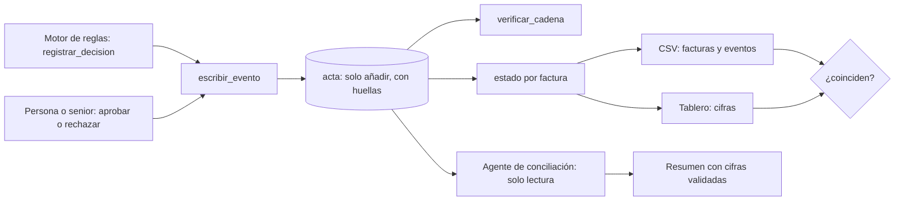

# Diseño: acta y CSV

Estado: **borrador para revisión del equipo**.
El diseño general está en `docs/Ruta-de-una-factura.pdf`. Este archivo solo baja a código la parte del registro y las cifras.

## Principios

1. **El acta es la única fuente de verdad.** El CSV, el tablero y el estado de cada factura son proyecciones calculadas. Nada se guarda dos veces (AC4.1, AC5.1).
2. **Solo se añade.** Ni la aplicación puede modificar o borrar filas (AC1.2).
3. **Transacciones cortas y completas.** Una fila y su huella se escriben juntas o no se escribe nada (AC1.5).
4. **Los números los calcula el código.** Con `Decimal`. La IA solo redacta (AC6.2, AC8.2).
5. **Una interfaz de almacenamiento, dos implementaciones.** PostgreSQL en Railway y SQLite en local, con las mismas pruebas.

## Estructura de carpetas

```
acta/
├─ esquema_postgres.sql   # tabla, permisos, trigger y roles
├─ esquema_sqlite.sql     # misma tabla y triggers para uso local
├─ almacen.py             # interfaz Almacen + AlmacenPostgres + AlmacenSqlite
├─ huella.py              # contenido canónico y SHA-256
├─ eventos.py             # tipos de evento y sus payloads (Pydantic)
├─ escribir.py            # escribir_evento: transacción, idempotencia, huella
├─ verificar.py           # verificar_cadena
├─ estado.py              # proyección: estado de cada factura y estado público
├─ exportar_csv.py        # facturas.csv y eventos.csv
├─ tablero.py             # cifras y comprobación de consistencia
├─ salas.py               # crear, reiniciar, purgar
└─ conciliacion.py        # agente de conciliación (capa 3) y resumen de respaldo
```

## Esquema de la tabla

```sql
CREATE TABLE acta (
  sala_id          text        NOT NULL,
  num              integer     NOT NULL,
  tipo             text        NOT NULL CHECK (tipo IN (
                     'DECISION','APROBACION','RECHAZO','CAMBIO_REGLA',
                     'INTENTO_RECHAZADO','REVISION_CONCILIACION','CIERRE_PERIODO')),
  factura_id       text,
  payload          jsonb       NOT NULL,          -- text en SQLite
  actor            text        NOT NULL,
  clave_idem       text        NOT NULL,
  huella_anterior  char(64)    NOT NULL,
  huella           char(64)    NOT NULL,
  creado_en        timestamptz NOT NULL DEFAULT now(),
  PRIMARY KEY (sala_id, num),
  UNIQUE (sala_id, clave_idem)
);

-- La aplicación solo puede leer y añadir.
REVOKE UPDATE, DELETE, TRUNCATE ON acta FROM usuario_app;
GRANT  SELECT, INSERT           ON acta TO   usuario_app;
GRANT  SELECT                   ON acta TO   usuario_lectura;   -- agente de conciliación

-- Segunda barrera: aunque alguien tenga permisos, la fila no se toca.
CREATE FUNCTION bloquear_cambios() RETURNS trigger AS $$
BEGIN RAISE EXCEPTION 'el acta es de solo añadir'; END; $$ LANGUAGE plpgsql;
CREATE TRIGGER acta_inmutable BEFORE UPDATE OR DELETE ON acta
  FOR EACH ROW EXECUTE FUNCTION bloquear_cambios();
```

En SQLite, la misma idea con `CREATE TRIGGER ... BEFORE UPDATE/DELETE ... SELECT RAISE(ABORT, 'el acta es de solo añadir')`.
La purga de salas (AC7.4) usa un tercer rol (`usuario_mantenimiento`) que no se entrega a la aplicación.

## Huella

```python
def contenido_canonico(fila) -> bytes:
    cuerpo = {"sala_id": ..., "num": ..., "tipo": ..., "factura_id": ...,
              "payload": ..., "actor": ..., "creado_en": iso_utc}
    return json.dumps(cuerpo, sort_keys=True, separators=(",", ":"),
                      ensure_ascii=False, default=texto_canonico).encode("utf-8")

def huella(huella_anterior: str, fila) -> str:
    return sha256(huella_anterior.encode() + contenido_canonico(fila)).hexdigest()

def huella_inicial(sala_id: str) -> str:
    return sha256(f"acta:{sala_id}".encode()).hexdigest()
```

`texto_canonico` convierte `Decimal` a texto con dos decimales (la tasa, con seis), y las fechas a ISO 8601 en UTC. Así la huella no depende del idioma, de la zona horaria ni del formato de la base de datos.

## Escribir un evento (AC1.1, AC1.4 a AC1.6)

```python
def escribir_evento(sala_id, tipo, factura_id, payload, actor, clave_idem):
    with almacen.transaccion(sala_id):             # bloqueo por sala
        existente = almacen.buscar_por_clave(sala_id, clave_idem)
        if existente:                              # idempotencia
            return existente
        ultimo = almacen.ultima_fila(sala_id)      # num y huella
        num = (ultimo.num + 1) if ultimo else 1
        anterior = ultimo.huella if ultimo else huella_inicial(sala_id)
        fila = Fila(sala_id, num, tipo, factura_id, payload, actor, ahora_utc(),
                    clave_idem, anterior)
        fila.huella = huella(anterior, fila)
        almacen.insertar(fila)
        return fila
```

- **PostgreSQL:** `pg_advisory_xact_lock(hashtext(sala_id))` al inicio de la transacción. Con el bloqueo por sala, dos escrituras seguidas no pueden tomar el mismo número.
- **SQLite:** `BEGIN IMMEDIATE`.
- **Clave de idempotencia:** `sha256(tipo | factura_id | version_reglas | payload canónico)`. Un reintento idéntico devuelve la misma fila.

## Verificar la cadena (AC2.3)

```python
def verificar_cadena(sala_id):
    anterior = huella_inicial(sala_id)
    for fila in almacen.filas(sala_id, orden="num"):
        if fila.huella_anterior != anterior or fila.huella != huella(anterior, fila):
            return Resultado(correcta=False, primera_fila_mala=fila.num)
        anterior = fila.huella
    return Resultado(correcta=True, filas=n)
```

Además comprueba que los números sean consecutivos, sin saltos.

## Proyección de estado (AC4)

```python
def estado_por_factura(filas):
    estado = {}
    for fila in filas:                      # en orden
        f = fila.factura_id
        if f is None: continue
        if fila.tipo == "DECISION":
            d = fila.payload["decision"]
            estado[f] = "PAGADA" if d == "PAGAR" else "FRENADA" if d == "FRENAR" else "PENDIENTE"
        elif fila.tipo == "APROBACION":  estado[f] = "PAGADA"
        elif fila.tipo == "RECHAZO":     estado[f] = "RECHAZADA"
    return estado
```

**Estado público (AC4.3):** una función aparte con una lista cerrada de salidas.
Del acta salen solo dos valores: «en revisión» (decisión `ESCALAR` sin resolver) y «resuelta» (cualquier otro caso). «Recibida» y «datos confirmados» no son eventos del acta: los aporta el agente de entrada antes de que el motor decida. La función nunca devuelve motivos, reglas ni montos.

## CSV (AC5)

- Se arma con `csv.writer` sobre un buffer, con `newline=""`, y se codifica como `utf-8-sig` (BOM).
- Filas ordenadas por `fila_acta`, columnas en el orden de AC5.3.
- Neutralización de fórmulas: función `seguro(celda)` que antepone `'` si empieza con `=`, `+`, `-` o `@`. Se aplica a todo texto que venga de una persona o de la factura.
- Montos como texto con punto decimal y dos decimales.
- `huella_corta`: los primeros 10 caracteres de la huella de la fila.
- Variante con punto y coma (DA3): misma función con otro `delimiter`.

## Tablero y consistencia (AC6)

```python
def cifras(sala_id, periodo):
    filas = almacen.filas(sala_id)
    estados = estado_por_factura(filas)
    gasto = sum(monto_base(f) for f in facturas_pagadas(filas, periodo))
    return Cifras(pagadas=..., frenadas=..., pendientes=..., atrasadas=...,
                  gasto=gasto, porcentaje=gasto / presupuesto, actualizado=ahora_utc())

def comprobar_consistencia(sala_id):
    desde_acta = cifras(sala_id, periodo)
    desde_csv  = totales_del_csv(exportar_facturas(sala_id))
    return desde_acta == desde_csv      # si no, aviso y registro del error
```

Las «atrasadas» las calcula el motor de reglas (R6.4). El tablero solo las muestra.

## Salas (AC7)

- `sala_id`: código corto aleatorio (por ejemplo, 8 caracteres) sin datos personales.
- Todas las funciones de `almacen` reciben `sala_id` y lo usan en el `WHERE`. No hay una función que lea sin sala.
- `reiniciar(sala_id)` crea una sala nueva y carga los datos de ejemplo (reglas, registros, calendario y 20 casos).
- `purgar(horas)` corre con el rol de mantenimiento, por una tarea programada o a mano.

## Conciliación (AC8, capa 3)

```python
def conciliar(sala_id, periodo):
    totales = cifras(sala_id, periodo)
    filas = filas_relevantes(sala_id, periodo)
    alertas = alertas_deterministas(sala_id, periodo)      # AC8.4, sin IA
    try:
        borrador = modelo.redactar(totales, filas, alertas)  # salida con esquema cerrado
        validar_cifras(borrador, totales, filas)              # AC8.3
        return borrador
    except Exception:
        return resumen_de_respaldo(totales, alertas)          # AC8.5
```

- Las **alertas** se calculan con código. La IA solo las redacta mejor.
- El **esquema de salida** del modelo: `resumen`, `alertas[{tipo, texto, filas[]}]`, `cifras[{nombre, valor, filas[]}]`.
- `validar_cifras` comprueba que cada cifra citada exista en `totales` con el mismo valor, y que cada fila citada exista.
- Los motivos escritos por personas van al modelo dentro de un bloque marcado como datos (AC8.7).
- Conexión con `usuario_lectura`, sin permiso de escritura (AC8.1).

## Interfaz con el motor de reglas

El motor de reglas llama:
```python
registrar_decision(...)  # en guardarrail.py, spec motor-de-reglas (R8.1)
    -> escribir_evento(sala_id, "DECISION", factura_id, payload_decision, actor, clave)
```
Para una aprobación: `escribir_evento(..., "APROBACION" | "RECHAZO", ...)` después de `validar_aprobacion`. Si `escribir_evento` falla, el guardarraíl devuelve un error y la interfaz no muestra el pago como hecho.

## Diagrama



## Estrategia de pruebas

- **Contra el almacén real:** las pruebas corren sobre SQLite y, si hay base disponible, también sobre PostgreSQL.
- **Inmutabilidad:** intentar `UPDATE` y `DELETE` desde el usuario de la aplicación debe fallar (AC9.2).
- **Manipulación:** cambiar el contenido de una fila a mano (con otro usuario) y verificar que se señala esa fila (AC9.3).
- **Concurrencia:** lanzar varias escrituras a la vez a una sala y comprobar números consecutivos sin repetir (AC9.5).
- **Consistencia:** con los 20 casos, tablero, CSV y acta suman lo mismo (AC9.4).
- **CSV:** celdas con `=1+1`, `+cmd`, `-2` y `@x` salen con apóstrofo (AC9.6). La misma acta da el mismo archivo (AC5.7).
- **Salas:** dos salas no se ven entre sí (AC9.7).
- **Idempotencia:** repetir un evento no crea otra fila (AC9.8).
- **Conciliación:** un borrador con una cifra inventada se descarta y sale el respaldo (AC8.3).

## Riesgos

| Riesgo | Mitigación |
|---|---|
| Dos escrituras simultáneas rompen la numeración | Bloqueo por sala y clave única `(sala_id, num)` |
| La huella cambia por el formato de un número o una fecha | Contenido canónico y pruebas de huella con valores fijos |
| Una celda con fórmula se ejecuta al abrir el CSV | Neutralización con apóstrofo (AC5.5) |
| Un resumen del agente trae una cifra inventada | Validar contra los totales y usar el resumen de respaldo |
| El estado público filtra información interna | Lista cerrada de salidas y prueba específica |
| Un reinicio de la demo borra pruebas de un evaluador | Reiniciar crea una sala nueva y la anterior se purga después |
| Falta tiempo para PostgreSQL con permisos | Versión mínima en `tasks.md`: SQLite con triggers y la misma interfaz |
