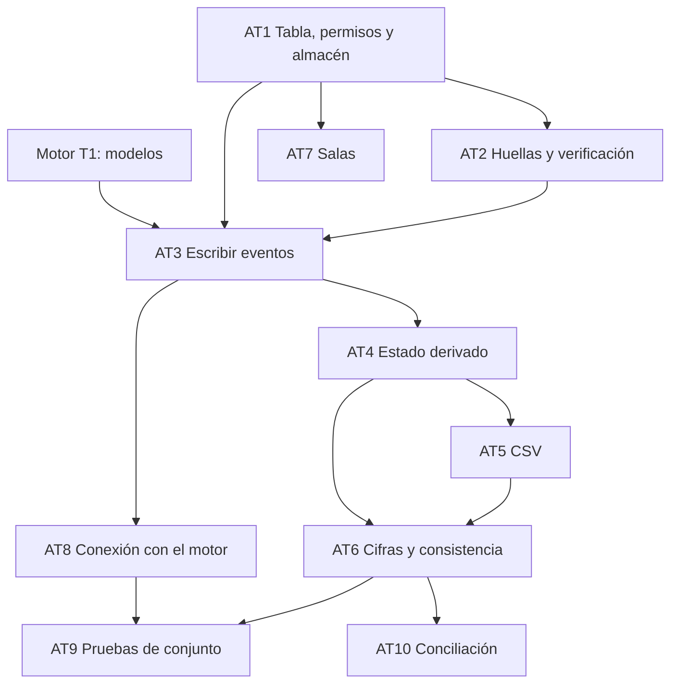

# Tareas: acta y CSV

Estado: **borrador para revisión del equipo**.
Requisitos: `requirements.md` · Diseño: `design.md`.

Las horas son **estimaciones mías**, para planear. Una tarea está lista cuando las pruebas de sus criterios pasan.

Dueños sugeridos: **A** motor y pruebas · **B** agentes · **C** pantallas · **D** datos, evaluación y pitch.
Como esta spec tiene bastante trabajo de infraestructura, se propone **C como responsable**, con A en la conexión con el motor y D en el CSV y las pruebas.

## Prioridad

| Capa | Qué incluye | Hasta cuándo |
|---|---|---|
| **Núcleo** | AT1 a AT9: tabla de solo añadir, huellas, escritura, estado, CSV, cifras y salas | Sábado 18:00 |
| **Capa 3** | AT10: agente de conciliación y resumen de respaldo | Solo si sobra tiempo |
| **A futuro** | Anclar la huella en una red pública | No se construye |

### Versión mínima si falta tiempo
Si a las 14:00 el núcleo va atrasado, se puede reducir así, sin perder los criterios de seguridad:
- Usar **solo SQLite** (con los triggers) en vez de PostgreSQL. Los datos se reinician con el despliegue.
- Generar **solo `facturas.csv`**, sin `eventos.csv`.
- Dejar la purga de salas (AC7.4) como un script manual.
- Mantener sin recortar: solo añadir (AC1.2), huellas y verificación (AC2), neutralización de fórmulas (AC5.5) y estado público (AC4.3).

## Estado de las tareas

Actualizado: sáb 17 oct, 14:00. Se construyó la **versión mínima** (ver abajo): SQLite con triggers, sin PostgreSQL. El código vive en `acta/`; las tareas se hicieron dentro de PT1 de `paneles-y-despliegue`.

| # | Tarea | Cubre | Estado |
|---|---|---|---|
| AT1 | Tabla, permisos y almacén | AC1.1, AC1.2, AC1.6, AC7.1 | **Parcial:** SQLite con triggers que impiden `UPDATE` y `DELETE` (`acta/esquema_sqlite.sql`, `almacen.py`). `esquema_postgres.sql` existe pero no se usa ni se probó (P13) |
| AT2 | Huellas y verificación | AC2.1 a AC2.4 | Hecho (`huella.py`, `verificar.py`; el acta muestra la verificación) |
| AT3 | Escribir eventos | AC1.3 a AC1.6, AC3.1 a AC3.6 | Hecho (`escribir.py`: tipos permitidos, idempotencia, transacción por sala, motivo de máx. 500). Los payloads no tienen un modelo Pydantic por tipo (`eventos.py` no existe) |
| AT4 | Estado derivado | AC4.1 a AC4.3 | Hecho (`estado.py`) |
| AT5 | CSV | AC5.1 a AC5.7 | Hecho (`exportar_csv.py`: los dos archivos, BOM, fórmulas neutralizadas, delimitador configurable) |
| AT6 | Cifras y consistencia | AC6.1 a AC6.5 | Hecho (`tablero.py`) |
| AT7 | Salas | AC7.1 a AC7.4 | **Parcial:** crear y aislar salas (`salas.py`). Falta reiniciar desde la pantalla y la purga de salas viejas (AC7.4, P21) |
| AT8 | Conexión con el motor de reglas | T15 | Hecho (`engine/guardarrail.py` llama a `escribir_evento`) |
| AT9 | Pruebas de conjunto | AC9.1 a AC9.9 | **Parcial:** cubiertas AC9.2, AC9.3, AC9.4, AC9.5 (6 visitantes a la vez), AC9.6, AC9.7 y AC9.8. Falta la medición de tiempos (AC9.9) |
| AT10 | Conciliación | AC8.1 a AC8.7 | Pendiente (capa 3) |

## Dependencias

## Tareas

### AT1. Tabla, permisos y almacén
- **Dueño:** C · **Estimación:** 1,5 h · **Capa:** núcleo
- Crear `esquema_postgres.sql` y `esquema_sqlite.sql` (tabla, restricción única, triggers y roles), y `almacen.py` con la interfaz y las dos implementaciones.
- **Cubre:** AC1.1, AC1.2, AC1.6 (la restricción), AC7.1 (el filtro por sala)
- **Listo cuando:** `UPDATE` y `DELETE` desde el usuario de la aplicación fallan en las dos bases.

### AT2. Huellas y verificación
- **Dueño:** C · **Estimación:** 1 h · **Capa:** núcleo
- `huella.py` (contenido canónico, huella inicial) y `verificar.py`.
- **Cubre:** AC2.1 a AC2.4
- **Listo cuando:** una huella de ejemplo con valores fijos da siempre el mismo resultado, y alterar una fila hace que la verificación señale cuál es.

### AT3. Escribir eventos
- **Dueño:** C (con A para los payloads) · **Estimación:** 1 h · **Capa:** núcleo
- `eventos.py` (los 7 tipos con Pydantic) y `escribir.py` (transacción, bloqueo por sala, idempotencia).
- **Cubre:** AC1.3 a AC1.6, AC3.1 a AC3.6
- **Listo cuando:** escrituras simultáneas no repiten ni saltan números, y repetir un evento no crea otra fila.

### AT4. Estado derivado
- **Dueño:** C · **Estimación:** 0,75 h · **Capa:** núcleo
- `estado.py`: estado por factura y estado público.
- **Cubre:** AC4.1 a AC4.3
- **Listo cuando:** el estado público nunca contiene motivos, reglas ni montos de umbrales.

### AT5. CSV
- **Dueño:** D (apoyo C) · **Estimación:** 1 h · **Capa:** núcleo
- `exportar_csv.py`: `facturas.csv` y `eventos.csv`, BOM, neutralización de fórmulas, columna `supuesto` y variante con punto y coma.
- **Cubre:** AC5.1 a AC5.7
- **Listo cuando:** el CSV abre bien en una hoja de cálculo y una celda `=1+1` sale como texto.

### AT6. Cifras y consistencia
- **Dueño:** C · **Estimación:** 1 h · **Capa:** núcleo
- `tablero.py`: cifras, hora de actualización y comprobación de que tablero, CSV y acta coinciden.
- **Cubre:** AC6.1 a AC6.5
- **Listo cuando:** con los 20 casos las tres cifras coinciden, y forzar una diferencia dispara el aviso.

### AT7. Salas
- **Dueño:** C · **Estimación:** 0,75 h · **Capa:** núcleo
- `salas.py`: crear, reiniciar (sala nueva con datos de ejemplo) y purgar (script de mantenimiento).
- **Cubre:** AC7.1 a AC7.4
- **Listo cuando:** una sala no puede leer otra y reiniciar deja intacta la anterior.

### AT8. Conexión con el motor de reglas
- **Dueño:** A con C · **Estimación:** 0,75 h · **Capa:** núcleo
- Conectar `registrar_decision` y las aprobaciones con `escribir_evento`. Es la tarea T15 de la spec del motor.
- **Listo cuando:** una decisión aprobada queda en el acta con versión de reglas, motivo, revisiones y canal, y si la escritura falla, el motor no la da por hecha.

### AT9. Pruebas de conjunto
- **Dueño:** D con C · **Estimación:** 1,25 h · **Capa:** núcleo
- Pruebas AC9.1 a AC9.9 sobre las 20 facturas, y el script que alimenta `eval.py` con la verificación de la cadena.
- **Listo cuando:** pasan en SQLite y, si hay base disponible, en PostgreSQL.

### AT10. Conciliación
- **Dueño:** B · **Estimación:** 2 h · **Capa:** capa 3
- `conciliacion.py`: alertas con código, redacción con IA, validación de cifras y resumen de respaldo, con el usuario de solo lectura.
- **Cubre:** AC8.1 a AC8.7
- **Listo cuando:** un borrador con una cifra inventada se descarta, y sin clave de API sale el resumen de respaldo.

## Trazabilidad

Las pruebas del acta quedaron en un solo archivo, `tests/test_acta.py`, y no en los archivos separados que planeaba esta spec (`test_acta_inmutable.py`, `test_acta_escribir.py`, `test_acta_huellas.py`, `test_acta_eventos.py`, `test_acta_estado.py`, `test_tablero.py`, `test_salas.py`). Esta tabla apunta a donde están de verdad (corregido el 17 oct).

| Requisito | Tarea | Archivo de pruebas | Prueba |
|---|---|---|---|
| AC1.1, AC1.2 | AT1 | `tests/test_acta.py` | `test_ac1_1_numeros_consecutivos`, `test_ac1_2_no_se_modifica_ni_borra` |
| AC1.3, AC1.4 | AT3 | `tests/test_acta.py` | `test_ac1_3_tipo_no_permitido`, `test_ac1_4_idempotencia` |
| AC1.6 | AT3 | `tests/test_acta.py` | `test_pd1_6_varios_visitantes_a_la_vez` |
| AC2.* | AT2 | `tests/test_acta.py` | `test_ac2_3_cadena_correcta_y_alterada` |
| AC3.1 | AT3, AT8 | `tests/test_guardarrail.py` | `test_r8_1_una_decision_buena_se_registra_con_su_motivo` |
| AC3.2, AC3.4 | AT3 | `tests/test_paneles.py` | `test_pp5_3_rol_insuficiente_queda_en_el_acta`, `test_pp5_5_aprobar_registra_canal_y_pasa_a_pagada` |
| AC3.3 | AT3 | `tests/test_reglas_pagina.py` | `test_pp8_6_el_acta_guarda_antes_despues_y_quien` |
| AC4.* | AT4 | `tests/test_acta.py` | `test_ac4_3_estado_publico_lista_cerrada` |
| AC5.* | AT5 | `tests/test_acta.py` | `test_ac5_5_formulas_neutralizadas`, `test_ac5_4_csv_con_bom_y_ac5_7_determinista` |
| AC6.* | AT6 | `tests/test_acta.py` | `test_ac6_1_cifras_con_decimal`, `test_ac6_3_tablero_csv_y_acta_coinciden` |
| AC7.1 | AT7 | `tests/test_acta.py` | `test_ac7_1_una_sala_no_lee_a_otra`, `test_codigo_de_sala` |
| AC7.3, AC7.4 | AT7 | — | Sin prueba: no implementado |
| AC8.* | AT10 | — | Sin prueba: capa 3, no implementado |
| AC9.9 | AT9 | — | Sin prueba de tiempos |

## Orden sugerido

1. **Ahora a 12:30:** AT1 y AT2, con los modelos del motor (T1) ya disponibles.
2. **12:30 a 14:00:** AT3 y AT4.
3. **14:00 a 16:00:** AT5, AT6 y AT7, junto con las pantallas.
4. **16:00 a 18:00:** AT8 y AT9. Las cifras alimentan el control de las 18:00.
5. **Después del control:** AT10, solo si sobra tiempo.
