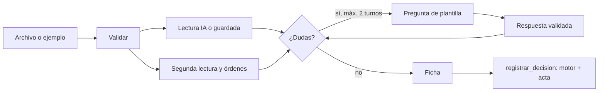

# Diseño: extracción y agente de entrada

Estado: **borrador para revisión del equipo**. Requisitos: `requirements.md`.

## Principios

1. **La IA solo lee.** Una sola llamada al modelo por factura, con salida de esquema cerrado. Preguntas, respuestas, segunda lectura y órdenes escondidas se resuelven con código.
2. **Dato no confiable.** El contenido de la factura y del chat nunca llega al motor ni se obedece.
3. **Falla segura.** Sin clave, con error o con salida inválida: lectura dudosa, y por tanto escalar.
4. **El motor decide.** El agente arma la ficha y llama a `registrar_decision`.

## Estructura

```
agents/
├─ archivo.py          # validar tipo, tamaño y firma de bytes; extraer texto
├─ lectura_ia.py       # elige proveedor (Gemini o Claude), esquema cerrado, limpieza común
├─ segunda_lectura.py  # patrones de texto: monto, fecha, moneda, beneficiario
├─ seguridad.py        # detectar órdenes escondidas
├─ aclaraciones.py     # plantillas de preguntas y validación de respuestas
├─ estado.py           # tabla `entrada` (no es el acta)
├─ flujo.py            # recibir, responder, finalizar → registrar_decision
└─ ejemplos.py         # 4 facturas de ejemplo y lecturas guardadas (modo demo)
```

## Flujo



## Piezas con lógica propia

**Segunda lectura.** Montos: se aceptan `2.400.000`, `2,400,000.00` y `2400000`; si hay punto y coma, el último separador es el decimal; con un solo separador y tres dígitos después, es de miles. Moneda: código de tres letras junto al monto. Fecha: `AAAA-MM-DD` o `DD/MM/AAAA`. Beneficiario: línea `Proveedor:` o `De:`.

**XML de varios países (EA10, EA11).** `xml_factura.py` reconoce el formato por el nombre local de la raíz. UBL 2.1 (Colombia, Perú) conserva su lectura propia (EA10). Los demás formatos se leen con la tabla `FORMATOS`: por cada campo, una lista de rutas alternativas (`Emisor/RznSoc`), donde `+` une partes con «-» (`IdDoc/Serie+IdDoc/Nro`) y `@` lee un atributo (`Emisor/@Rfc`; `@Total` es un atributo de la raíz). Cada paso de la ruta busca el primer descendiente con ese nombre, así que los envoltorios (`nfeProc`, `EnvioDTE`, `rDE`) no estorban. La segunda lectura (`segunda_lectura.leer_xml`) resuelve las mismas rutas con expresiones regulares sobre el texto, sin el analizador. El sobre `autorizacion` del SRI trae la factura en un CDATA: se desenvuelve como el `AttachedDocument` de la DIAN. Un XML bien formado de raíz desconocida lanza `FormatoDesconocido` y el flujo lo lee como texto; su segunda lectura no encuentra los campos, así que queda `no_disponible` y el motor escala (R2.2).

| Formato | País | Raíz | Moneda | Vencimiento |
|---|---|---|---|---|
| UBL 2.1 | Colombia (DIAN), Perú (SUNAT) | `Invoice` | `currencyID` | `DueDate` / `PaymentDueDate` |
| CFDI 4.0 | México | `Comprobante` | `@Moneda` | No trae |
| Comprobante SRI | Ecuador | `factura` | `moneda` («DOLAR» → USD) | No trae |
| CFE | Uruguay | `CFE` | `TpoMoneda` | `FchVenc` |
| NF-e | Brasil | `nfeProc`, `NFe` | BRL por esquema | `dup/dVenc` |
| DTE | Chile | `DTE`, `EnvioDTE` | CLP por esquema | `FchVenc` |
| Factura electrónica | Costa Rica | `FacturaElectronica` | `CodigoMoneda` (CRC si falta) | No trae |
| SIFEN | Paraguay | `rDE`, `DE` | `cMoneOpe` | `dVencCuo` |
| Sin XML común | Argentina (ARCA valida por servicio web con CAE), Venezuela (factura digital de imprenta autorizada) | — | Se lee como texto y se escala | — |

**Dudosos.** Un campo es dudoso si la IA no lo entregó, o si la segunda lectura lo encontró distinto o no lo encontró.

**Órdenes escondidas.** Lista cerrada de expresiones regulares en español e inglés. Es una señal que solo suma cautela: nunca autoriza nada.

**Modo demo.** Las facturas de ejemplo son archivos de texto reales, así que la segunda lectura y la detección corren de verdad; solo la lectura de IA viene de `lecturas_guardadas`.

**Proveedores.** `lectura_ia.py` tiene una función por proveedor que devuelve el JSON en bruto, y una limpieza común. Claude usa `messages.create` con `output_config.format`; Gemini usa `models.generate_content` con `response_mime_type="application/json"` y `response_json_schema` (el mismo esquema). Los dos reciben las mismas instrucciones de sistema y el contenido de la factura marcado como dato. Selección: `PROVEEDOR_IA`, o automática por las claves disponibles (Claude primero).

**Diagnóstico (EA2b.6 a EA2b.8).** `lectura_ia.diagnostico()` devuelve el proveedor activo, el estado de cada variable (definida, vacía o no definida; los valores de modelo y modo sí se muestran, los de clave nunca), la razón del modo demo, los nombres de variables parecidas pero distintas y los datos del despliegue que Railway inyecta (`RAILWAY_ENVIRONMENT_NAME`, `RAILWAY_SERVICE_NAME`, `RAILWAY_GIT_COMMIT_SHA`). El Panel 1 lo muestra solo con `?diagnostico=1`, porque no depende de ninguna variable de entorno: si el problema fuera justamente que una variable no llega, el diagnóstico seguiría disponible.

**Esquema de salida de la IA.** Objeto con `beneficiario`, `numero`, `monto`, `moneda`, `vence`, `cuenta` (texto o nulo) y `dudosos` (lista), con `additionalProperties: false`.

## Pruebas

Cliente falso que devuelve JSON fijo, sin red. Las cuatro facturas de ejemplo pasan por el flujo completo y el motor.

## Riesgos

| Riesgo | Mitigación |
|---|---|
| Inyección de instrucciones en la factura | Bloque de datos marcado, esquema cerrado, patrones deterministas y el motor sin acceso al texto |
| El modelo lee mal un monto | Segunda lectura sin IA; si difieren, se escala |
| Archivo disfrazado | Firma de bytes, no solo extensión; tamaño máximo |
| La API falla en la demo | Modo demo con lecturas guardadas; archivos propios siempre se escalan |
| Costo | Una llamada por factura y límite de 5 por sala |
