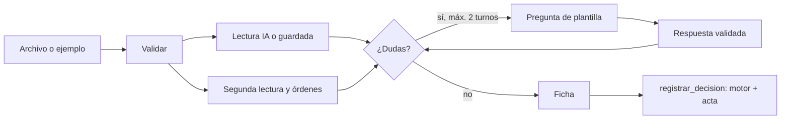

# Diseño: extracción y agente de entrada

Estado: **borrador para revisión del equipo**. Requisitos: `requirements.md`.

## Principios

1. **La IA solo lee.** Una sola llamada al modelo por factura, con salida de esquema cerrado. Preguntas, respuestas, segunda lectura y órdenes escondidas se resuelven con código.
2. **Dato no confiable.** El contenido de la factura y del chat nunca llega al motor ni se obedece.
3. **Falla segura.** Sin clave, con error o con salida inválida: lectura dudosa, y por tanto escalar.
4. **El motor decide.** El agente arma la ficha y llama a `registrar_decision`.

## Estructura

```
agents/
├─ archivo.py          # validar tipo, tamaño y firma de bytes; extraer texto
├─ lectura_ia.py       # llamada a Claude (esquema cerrado) y cliente inyectable
├─ segunda_lectura.py  # patrones de texto: monto, fecha, moneda, beneficiario
├─ seguridad.py        # detectar órdenes escondidas
├─ aclaraciones.py     # plantillas de preguntas y validación de respuestas
├─ estado.py           # tabla `entrada` (no es el acta)
├─ flujo.py            # recibir, responder, finalizar → registrar_decision
└─ ejemplos.py         # 4 facturas de ejemplo y lecturas guardadas (modo demo)
```

## Flujo



## Piezas con lógica propia

**Segunda lectura.** Montos: se aceptan `2.400.000`, `2,400,000.00` y `2400000`; si hay punto y coma, el último separador es el decimal; con un solo separador y tres dígitos después, es de miles. Moneda: código de tres letras junto al monto. Fecha: `AAAA-MM-DD` o `DD/MM/AAAA`. Beneficiario: línea `Proveedor:` o `De:`.

**Dudosos.** Un campo es dudoso si la IA no lo entregó, o si la segunda lectura lo encontró distinto o no lo encontró.

**Órdenes escondidas.** Lista cerrada de expresiones regulares en español e inglés. Es una señal que solo suma cautela: nunca autoriza nada.

**Modo demo.** Las facturas de ejemplo son archivos de texto reales, así que la segunda lectura y la detección corren de verdad; solo la lectura de IA viene de `lecturas_guardadas`.

**Esquema de salida de la IA.** Objeto con `beneficiario`, `numero`, `monto`, `moneda`, `vence`, `cuenta` (texto o nulo) y `dudosos` (lista), con `additionalProperties: false`.

## Pruebas

Cliente falso que devuelve JSON fijo, sin red. Las cuatro facturas de ejemplo pasan por el flujo completo y el motor.

## Riesgos

| Riesgo | Mitigación |
|---|---|
| Inyección de instrucciones en la factura | Bloque de datos marcado, esquema cerrado, patrones deterministas y el motor sin acceso al texto |
| El modelo lee mal un monto | Segunda lectura sin IA; si difieren, se escala |
| Archivo disfrazado | Firma de bytes, no solo extensión; tamaño máximo |
| La API falla en la demo | Modo demo con lecturas guardadas; archivos propios siempre se escalan |
| Costo | Una llamada por factura y límite de 5 por sala |
