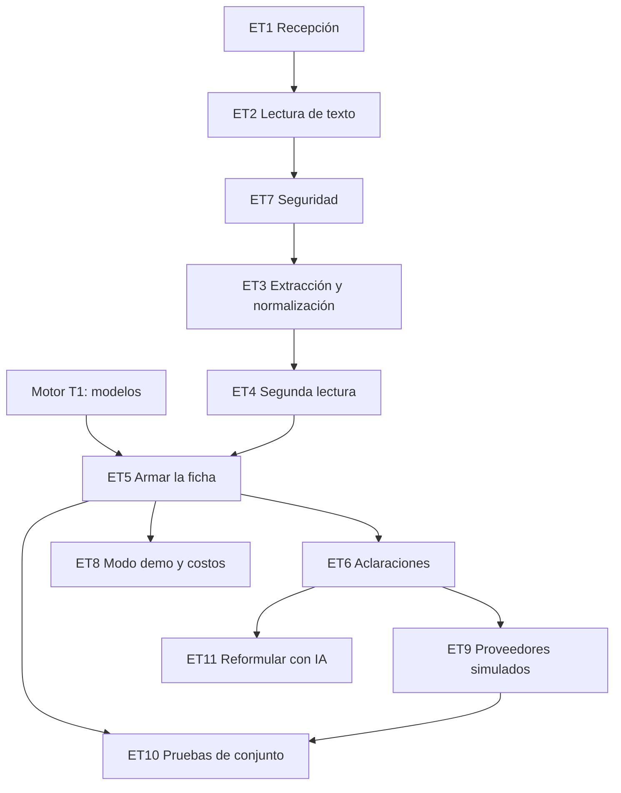

# Tareas: extracción y agente de entrada

Estado: **borrador para revisión del equipo**.
Requisitos: `requirements.md` · Diseño: `design.md`.

Las horas son **estimaciones mías**, para planear. Una tarea está lista cuando las pruebas de sus criterios pasan.

Dueños sugeridos: **A** motor y pruebas · **B** agentes · **C** pantallas · **D** datos, evaluación y pitch.
Esta spec es de **B**, con D en los guiones y los casos, y A en el contrato de la ficha.

## Prioridad

| Capa | Qué incluye | Hasta cuándo |
|---|---|---|
| **Núcleo** | ET1 a ET5, ET7, ET8 y ET10: recepción, lectura, extracción, segunda lectura, ficha, seguridad, modo demo y pruebas | Sábado 18:00 |
| **Capa 3** | ET6 (preguntas al proveedor) y ET9 (proveedores simulados); ET11 (reformular con IA) | Solo si sobra tiempo |

Sin las aclaraciones, el agente ya cumple lo esencial: si falta un dato o hay duda, la ficha sale marcada como dudosa y el motor la escala.

### Versión mínima si falta tiempo
- **Solo entradas con texto** (PDF con texto, correo, chat, TXT). Las imágenes quedan con `segunda_lectura = no_disponible`, así que el motor las escala.
- **Una sola pregunta** al proveedor, en vez de dos turnos.
- **Sin verificador ni OCR.**
- Mantener sin recortar: esquema cerrado, segunda lectura de texto, datos delimitados, ficha sin texto libre y modo demo.

## Dependencias

## Tareas

### ET1. Recepción
- **Dueño:** B (apoyo C) · **Estimación:** 1 h · **Capa:** núcleo
- `recepcion.py`: tipo por contenido, tamaño, páginas, límite por sala, `factura_id` y `preparador`.
- **Cubre:** EX1.1 a EX1.7
- **Listo cuando:** un `.exe` renombrado a `.pdf` se rechaza, un archivo de 6 MB se rechaza y la sexta factura de una sala se rechaza.

### ET2. Lectura de texto
- **Dueño:** B · **Estimación:** 1 h · **Capa:** núcleo
- `lectura_texto.py`: texto de PDF (`pdfplumber` o `PyMuPDF`), EML (módulo `email`, sin abrir adjuntos), TXT y chat.
- **Cubre:** EX1.7, EX5.3 (parte)
- **Listo cuando:** de un PDF, un correo y un chat sale el texto, y un PDF con enlaces o scripts no ejecuta nada.

### ET7. Seguridad
- **Dueño:** B · **Estimación:** 1 h · **Capa:** núcleo
- `seguridad.py`: depurar, delimitar como datos, detectar órdenes y la lista de bloqueo de salida.
- **Cubre:** EX5.1 a EX5.6, EX4.5 (bloqueo de salida)
- **Listo cuando:** los 6 ejemplos de órdenes activan la alerta y no cambian la ficha.

### ET3. Extracción y normalización
- **Dueño:** B · **Estimación:** 2 h · **Capa:** núcleo
- `extraer.py`, `normalizar.py` y los prompts. Salida estructurada, reintento, `null` si no aparece, formatos de monto, moneda y fecha en español e inglés.
- **Cubre:** EX2.1 a EX2.8
- **Listo cuando:** `tests/test_normalizar.py` pasa, y con las 20 facturas, al menos 18 dan la ficha esperada.

### ET4. Segunda lectura
- **Dueño:** B · **Estimación:** 1,5 h · **Capa:** núcleo (patrones de texto) · capa 3 (verificador para imágenes)
- `segunda_lectura.py`: patrones sobre el texto, comparación campo por campo, lista de campos distintos. El verificador independiente de imágenes entra si hay tiempo.
- **Cubre:** EX3.1 a EX3.6
- **Listo cuando:** un monto multiplicado por 10 da `no_coincide`, y una imagen sin verificador da `no_disponible`.

### ET5. Armar la ficha
- **Dueño:** B con A · **Estimación:** 1 h · **Capa:** núcleo
- `ficha.py`: construir la `Ficha` del motor de reglas con origen de campos, campos distintos, alerta y aclaraciones. Calcular `campos_a_aclarar`.
- **Cubre:** EX6.1 a EX6.5, EX4.1
- **Listo cuando:** la ficha valida contra el modelo del motor y los campos faltantes quedan en `null` con `lectura_ia = dudosa`.

### ET8. Modo demo y costos
- **Dueño:** B (apoyo D) · **Estimación:** 1,25 h · **Capa:** núcleo
- `modo_demo.py`: respuestas guardadas por huella, activación sin clave o con fallo, aviso visible, timeouts, límite de llamadas y registro de llamadas.
- **Cubre:** EX7.1 a EX7.4
- **Listo cuando:** sin clave de API, una factura de ejemplo da su ficha y una desconocida da una ficha dudosa.

### ET6. Aclaraciones
- **Dueño:** B · **Estimación:** 1,5 h · **Capa:** capa 3
- `aclarar.py`: plantillas, una pregunta por turno, `max_turnos`, extractor de respuestas, original contra aclarado y registro de cada turno.
- **Cubre:** EX4.2 a EX4.10
- **Listo cuando:** ningún guion pasa de 2 turnos, el valor original nunca se pisa y el agente no revela datos internos.

### ET9. Proveedores simulados
- **Dueño:** D · **Estimación:** 1,25 h · **Capa:** capa 3
- `proveedores_simulados.py` con los tres guiones y los casos de lectura del set de 20 facturas, incluidas las órdenes escondidas.
- **Cubre:** EX8.1 a EX8.3
- **Listo cuando:** cada guion devuelve las mismas respuestas en cada corrida.

### ET10. Pruebas de conjunto
- **Dueño:** B con D · **Estimación:** 1,5 h · **Capa:** núcleo
- Pruebas de EX9: tabla de extracción, lectura alterada, órdenes escondidas, guiones, filtración y modo demo. Las que usan el modelo real llevan la marca `@pytest.mark.modelo`.
- **Cubre:** EX9.1 a EX9.7
- **Listo cuando:** el resto de las pruebas pasa sin clave y las marcadas pasan con clave.

### ET11. Reformular preguntas con IA
- **Dueño:** B · **Estimación:** 0,5 h · **Capa:** capa 3, opcional
- Reformular la plantilla con IA y validar que no aparezcan cifras ni nombres nuevos.
- **Cubre:** EX4.3 (rama con IA)
- **Listo cuando:** una reformulación con un dato añadido se descarta y se usa la plantilla.

## Trazabilidad

| Requisito | Tarea | Archivo de pruebas |
|---|---|---|
| EX1.* | ET1, ET2 | `tests/test_entrada_recepcion.py` |
| EX2.* | ET3 | `tests/test_entrada_extraccion.py`, `tests/test_normalizar.py` |
| EX3.* | ET4 | `tests/test_entrada_segunda_lectura.py` |
| EX4.1 | ET5 | `tests/test_entrada_ficha.py` |
| EX4.2 a EX4.10 | ET6 | `tests/test_entrada_aclarar.py` |
| EX4.5 (bloqueo) | ET7 | `tests/test_entrada_seguridad.py` |
| EX5.* | ET7 | `tests/test_entrada_seguridad.py` |
| EX6.* | ET5 | `tests/test_entrada_ficha.py` |
| EX7.* | ET8 | `tests/test_entrada_modo_demo.py` |
| EX8.* | ET9 | `tests/test_entrada_guiones.py` |
| EX9.1 | Todas | Una prueba por criterio |
| EX9.2 a EX9.7 | ET10 | Pruebas de conjunto en `tests/` |

## Orden sugerido

1. **Ahora a 12:30:** ET1 y ET2 (B). ET9 y los casos de lectura (D) en paralelo.
2. **12:30 a 14:00:** ET7 y ET3.
3. **14:00 a 16:00:** ET4, ET5 y ET8.
4. **16:00 a 18:00:** ET10 y la conexión de la ficha con el motor de reglas.
5. **Después del control de las 18:00:** ET6 y, con tiempo, el verificador para imágenes y ET11.
