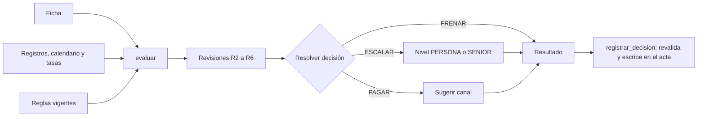

# Diseño: motor de reglas

Estado: **borrador para revisión del equipo**.
El diseño general del proyecto está en `docs/Ruta-de-una-factura.pdf`. Este archivo solo baja ese diseño a código para el motor de reglas, y no lo repite.

## Principios

1. **Función pura.** `evaluar(ficha, contexto, reglas) -> Resultado`. Sin red, sin IA y sin escribir en disco. Eso lo hace determinista (R1.6, R1.7) y fácil de probar.
2. **Fallo seguro.** Cualquier excepción dentro de una regla se convierte en una revisión `FALLA` y la decisión es `ESCALAR` (R1.3). Nunca se propaga como «pagar».
3. **Todas las reglas corren.** No se corta en la primera falla, así el motivo muestra todas las causas (R1.5).
4. **Esquemas cerrados.** Todo lo que entra y sale usa modelos de Pydantic. Lo que no encaja se rechaza.
5. **Dinero con `Decimal`.** Nunca `float`.

## Estructura de carpetas

```
engine/
├─ modelos.py        # Ficha, Contexto, Revision, Resultado, Reglas (Pydantic)
├─ evaluar.py        # orquestador: corre todas las revisiones y resuelve la decisión
├─ revisiones/
│  ├─ entrada.py     # esquema, lecturas que coinciden, diferencias (R2)
│  ├─ frenar.py      # duplicado, acuerdo, presupuesto, techo duro (R3)
│  ├─ beneficiario.py# lista permitida, cuenta (R4)
│  ├─ montos.py      # conversión, monto_para_nivel, límites (R5)
│  └─ calendario.py  # emparejar obligaciones, estados (R6)
├─ niveles.py        # nivel de aprobación (R5.3, R5.5)
├─ canales.py        # sugerencia de canal (R7)
├─ guardarrail.py    # registrar_decision y validar aprobaciones (R8)
├─ reglas_io.py      # cargar YAML, vigencias, versiones, afloja/restringe (R9.1 a R9.5)
└─ simular.py        # qué cambiaría con un cambio de reglas (R9.6)
data/
├─ reglas.yaml       # parámetros, vigencias y versión
├─ registros.yaml    # beneficiarios permitidos, cuentas, acuerdos, historial, presupuesto
├─ calendario.csv    # obligaciones esperadas del mes
├─ canales.yaml      # canales, países, monedas, costo y tiempo (todo «supuesto»)
└─ tasas.yaml        # tipos de cambio de ejemplo
```

## Modelos (resumen)

```python
class Ficha(BaseModel):
    factura_id: str
    beneficiario: str
    numero: str
    monto: Decimal
    moneda: str                      # ISO 4217
    vence: date
    cuenta_original: str | None
    cuenta_aclarada: str | None
    valores_aclarados: dict[str, Any]  # solo campos que el agente aclaró
    lectura_ia: Literal["ok", "dudosa"]
    segunda_lectura: Literal["coincide", "no_coincide"]
    preparador: str                  # quién subió el caso (R8.2)

class Revision(BaseModel):
    regla: str                       # por ejemplo "R3.1"
    resultado: Literal["OK", "FALLA", "AVISO"]
    efecto: Literal["FRENAR", "ESCALAR", "NINGUNO"]
    nivel: Literal["NINGUNO", "PERSONA", "SENIOR"]
    observado: str
    umbral: str
    mensaje: str

class Resultado(BaseModel):
    decision: Literal["PAGAR", "FRENAR", "ESCALAR"]
    nivel: Literal["NINGUNO", "PERSONA", "SENIOR"]
    revisiones: list[Revision]
    motivo: str
    version_reglas: str
    tasa_usada: Decimal | None
    canal: CanalSugerido | None
```

La ficha no incluye el texto libre de la factura. El agente de entrada lo guarda aparte, así el motor no puede leerlo (R2.4).

## Algoritmo de evaluación

```python
def evaluar(ficha, contexto, reglas):
    revisiones = []
    for revision in REVISIONES:               # todas, en orden fijo
        try:
            revisiones.append(revision(ficha, contexto, reglas))
        except Exception as error:            # R1.3
            revisiones.append(fallo_de_evaluacion(revision, error))

    decision = resolver(revisiones)           # R1.4
    nivel = nivel_maximo(revisiones, ficha, contexto, reglas)   # R5.3, R5.5
    if decision == "PAGAR" and nivel != "NINGUNO":              # R1.2
        decision = "ESCALAR"
    canal = sugerir_canal(...) if decision == "PAGAR" else None  # R7.1
    return Resultado(...)
```

**Resolver la decisión:** la más severa gana.
`FRENAR` (alguna revisión con efecto `FRENAR`) → `ESCALAR` (alguna `FALLA` o `AVISO`, o nivel distinto de `NINGUNO`) → `PAGAR`.

**Orden de las revisiones** (solo importa para la lectura del motivo):
1. Esquema de la ficha (R2.1)
2. Las dos lecturas coinciden (R2.2)
3. Diferencias aclarado contra original (R2.3)
4. Tipo de cambio (R5.1)
5. Duplicado (R3.1)
6. Beneficiario y cuenta (R4)
7. Calendario (R6)
8. Acuerdo y tolerancias (R3.2 a R3.5)
9. Presupuesto y techo duro (R3.6, R3.7)
10. Límite por periodo (R5.4)

## Piezas con lógica propia

**Huella de duplicado (R3.1):** `sha256(beneficiario | numero | monto | fecha)` sobre valores normalizados (mayúsculas, sin espacios extra, monto a dos decimales). Se compara con el historial.

**Nivel de aprobación (R5.2, R5.3):**
```
monto_para_nivel = pagado_o_aprobado_del_periodo(beneficiario) + monto_base
NINGUNO  si monto_para_nivel <= autopago_max
PERSONA  si monto_para_nivel <= persona_max
SENIOR   si no
```
Después se sube a `SENIOR` si cualquier revisión lo exige (R4.1, R4.2, R5.4, R2.3).

**Emparejar con el calendario (R6):** para cada obligación sin emparejar, mismo beneficiario, monto dentro de `tolerancia_ok` y fecha dentro de `ventana_dias`. Se toma la más cercana en fecha. Una vez emparejada, la obligación queda marcada y no se vuelve a usar (R6.3). El estado «atrasada» se calcula aparte, solo para el tablero (R6.4).

**Sugerir canal (R7):**
```
candidatos = canales que cubren (pais, moneda) del beneficiario
si no hay candidatos: "sin canal compatible"
ordenar por (costo, tiempo, ¿llega antes del vencimiento?)
etiquetas: Sugerido (primero), Alternativa (siguientes viables), Revisar (parcial), No sugerido
```
Los valores de costo y tiempo salen de `canales.yaml`, con `supuesto: true`. Si falta uno, se muestra «sin dato» y el canal no se ordena por ese criterio.

**Guardarraíl (R8):**
```python
def registrar_decision(resultado_propuesto, ficha, contexto, reglas, actor=None):
    recalculado = evaluar(ficha, contexto, reglas)
    if resultado_propuesto.decision == "PAGAR" and recalculado.decision != "PAGAR":
        raise DecisionRechazada("intento de pagar fuera de las reglas")   # R8.1
    if actor is not None:
        validar_aprobacion(actor, recalculado, ficha)                      # R8.2, R8.3, R8.5
    return escribir_evento(sala_id, "DECISION", ficha.factura_id, resultado_propuesto,
                           actor, clave_idem)   # lo implementa la spec acta-y-csv
```
`validar_aprobacion` comprueba: rol del actor mayor o igual al nivel exigido, motivo no vacío, actor distinto de `ficha.preparador`, y monto menor o igual a `techo_duro_pago`.

**Reglas versionadas (R9):**
- `reglas.yaml` tiene una lista de conjuntos con `version`, `vigente_desde`, `vigente_hasta` y los parámetros.
- Se carga con Pydantic. Si falla, se conserva la versión anterior y se informa el error (R9.1).
- Si dos conjuntos vigentes chocan, gana el más específico (por ejemplo, el de un solo beneficiario) y, a igual especificidad, el más estricto (R9.2).
- **Afloja o restringe (R9.4):** se compara cada parámetro antes y después. Se considera que afloja si sube `autopago_max`, `persona_max`, `limite_periodo_beneficiario` o `presupuesto_periodo`, si sube una tolerancia, si agrega un beneficiario o una obligación, o si quita un nivel. Si cualquiera afloja, el cambio completo exige la firma del senior.
- **Techos duros (R9.5):** viven en un archivo aparte (`techos.yaml`) que no edita el agente de reglas.

**Simular (R9.6):** `simular(cambio, historial[-N:])` evalúa cada factura con las reglas actuales y con las propuestas, y devuelve solo las que cambian de decisión. No toca el acta ni el calendario.

## Diagrama



## Estrategia de pruebas

- **Una prueba por criterio.** Nombre: `test_r3_1_duplicado_frena`, `test_r4_1_beneficiario_nuevo_escala_senior`, etc. La matriz de trazabilidad está en `tasks.md`.
- **Casos trampa en tabla** (`data/casos.yaml`): las 20 facturas con su decisión esperada. Cubren duplicado, beneficiario nuevo, no cuadra, monto sobre el límite, sin presupuesto, orden escondida, cuenta cambiada e inesperada.
- **Propiedades con Hypothesis** (R11.2): se generan fichas que violan una regla bloqueante al azar y se comprueba que nunca salga `PAGAR`.
- **Fallos inyectados:** una revisión que lanza excepción debe producir `ESCALAR` (R1.3).
- **Determinismo:** dos corridas iguales dan el mismo resultado (R1.7).

## Riesgos

| Riesgo | Mitigación |
|---|---|
| Un error de programación deja pasar un `PAGAR` | Guardarraíl al escribir (R8.1) y prueba de propiedades (R11.2) |
| El motor escala casi todo y baja la autonomía | Calibrar parámetros con las facturas normales; medirlo con `eval.py` |
| Parámetros de ejemplo que parezcan reales | Marcarlos como «de demostración» en pantalla y en el CSV |
| Los registros no están al día | Lo que no está registrado se escala (R4.1, R3.5) |

## Ajustes al construir (17 oct)

Decisiones tomadas al programar, para que spec y código no se separen:

1. **La ficha lleva dos campos más:** `recibida` (fecha de recepción; sirve para emparejar con el calendario, R6.1, y para elegir la versión de reglas, R9.2) y `orden_en_texto` (el agente de entrada avisa que el texto traía una orden; solo agrega un `AVISO`, nunca cambia una decisión a favor, R2.4).
2. **R5.3 es una revisión más:** `OK` si el nivel por monto es `NINGUNO`; si no, `AVISO` con ese nivel. Así `PAGAR` se reduce a «todas las revisiones `OK`».
3. **`ESCALAR` nunca queda con nivel `NINGUNO`:** si ninguna revisión pide nivel, se asigna `PERSONA` (alguien debe revisar). `FRENAR` queda con nivel `NINGUNO`.
4. **Sin tipo de cambio (R5.1) el nivel es `SENIOR`:** sin monto en moneda base no se puede medir nada, y las revisiones que dependen de él devuelven `FALLA` «no evaluable».
5. **Nivel y gasto cuentan distinto** (R5.2 frente a D2): `monto_para_nivel` suma lo pagado, aprobado o pendiente del beneficiario en el periodo; el gasto del presupuesto (R3.6) suma solo lo pagado o aprobado.
6. **El canal se calcula también para `ESCALAR`** (R7.1), para que quien aprueba lo vea. Sigue siendo solo recomendación. Canales con `requiere_verificacion` salen como «Revisar».
7. **Sin cuenta registrada** (beneficiario fuera de los registros) la revisión R4.2 es `FALLA` a nivel `SENIOR`: lo no registrado se escala.
8. **Contexto desde el acta** (`engine/contexto.py`): el historial, el gasto y las obligaciones ya emparejadas se derivan de los eventos del acta, no de otra tabla.
9. **Reglas:** `reglas.yaml` trae una lista de conjuntos con `vigente_desde`; se elige el más reciente vigente a la fecha de recepción. Los conflictos y el detector de afloja/restringe (T12) quedan para después. `techos.yaml` se aplica como mínimo sobre `techo_duro_pago`.
