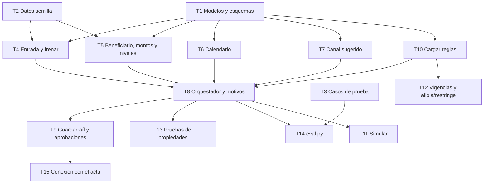

# Tareas: motor de reglas

Estado: **borrador para revisión del equipo**.
Requisitos: `requirements.md` · Diseño: `design.md`.

Las horas son **estimaciones mías**, para planear. Cambian si el equipo ya conoce las herramientas.
Una tarea está lista cuando las pruebas de sus criterios pasan y no usa red ni IA.

Dueños sugeridos, según el reparto del equipo: **A** motor y pruebas · **B** agentes · **C** pantallas · **D** datos, evaluación y pitch.

## Prioridad

| Capa | Qué incluye | Hasta cuándo |
|---|---|---|
| **Núcleo** | Decisión segura, entrada, frenar, beneficiario, montos y niveles, guardarraíl, explicabilidad, pruebas | Sábado 18:00 |
| **Capa 2** | Sugerencia de canal de pago (R7) | 18:00 a 21:00, si el control de las 18:00 pasa |
| **Capa 3** | Calendario (R6), reglas con vigencia y detección de afloja/restringe (R9.2, R9.4, R9.5), simular (R9.6) | Solo si sobra tiempo |

## Dependencias

## Ola 0: contratos y datos (en paralelo)

### T1. Modelos y esquemas
- **Dueño:** A · **Estimación:** 0,75 h · **Capa:** núcleo
- Crear `engine/modelos.py` con `Ficha`, `Contexto`, `Revision`, `Resultado` y `Reglas`, como en `design.md`.
- **Cubre:** R1.1, R2.1, R10.1
- **Listo cuando:** una ficha válida pasa, una con un campo extra o un monto negativo se rechaza, y el resto del equipo puede importar los modelos.

### T2. Datos semilla
- **Dueño:** D · **Estimación:** 1,5 h · **Capa:** núcleo
- Crear en `data/`: `reglas.yaml` (con los parámetros por defecto), `registros.yaml`, `calendario.csv` (unas 12 obligaciones), `canales.yaml`, `tasas.yaml` y `techos.yaml`.
- Todo valor de costo, tiempo o tasa lleva `supuesto: true`.
- **Cubre:** R3, R4, R5, R6, R7.4
- **Listo cuando:** todos los archivos cargan sin error con los modelos de T1.

### T3. Casos de prueba
- **Dueño:** D · **Estimación:** 1,5 h · **Capa:** núcleo
- Crear `data/casos.yaml` con 20 facturas ficticias. Cada una lleva la decisión esperada, el nivel esperado y los criterios que ejercita.
- Incluir: normal (varias), repetida, beneficiario nuevo, no cuadra (5 a 10 % y más de 10 %), sobre el umbral, sin presupuesto, cuenta cambiada, inesperada, orden escondida, lecturas que no coinciden y sin tipo de cambio.
- **Cubre:** R11.3
- **Listo cuando:** cada criterio de R2 a R5 tiene al menos un caso.

## Ola 1: revisiones (en paralelo, tras T1 y T2)

### T4. Entrada y frenar
- **Dueño:** A · **Estimación:** 1,5 h · **Capa:** núcleo
- `engine/revisiones/entrada.py` y `frenar.py`: esquema, lecturas que coinciden, diferencias, duplicado, acuerdo con tolerancias, presupuesto y techo duro.
- **Cubre:** R2.1 a R2.4, R3.1 a R3.7
- **Listo cuando:** `tests/test_entrada.py` y `tests/test_frenar.py` pasan.

### T5. Beneficiario, montos y niveles
- **Dueño:** A · **Estimación:** 1,5 h · **Capa:** núcleo
- `beneficiario.py`, `montos.py` y `niveles.py`: lista permitida, cuenta, conversión, `monto_para_nivel`, límite por periodo y nivel máximo.
- **Cubre:** R4.1 a R4.3, R5.1 a R5.5
- **Listo cuando:** `tests/test_beneficiario.py` y `tests/test_montos.py` pasan.

### T6. Calendario
- **Dueño:** A (apoyo B) · **Estimación:** 1 h · **Capa:** capa 3
- `calendario.py`: emparejar obligaciones una sola vez, `AVISO` de inesperada y estados «pendiente», «llegó» y «atrasada».
- **Cubre:** R6.1 a R6.4
- **Listo cuando:** `tests/test_calendario.py` pasa. Si se deja para después, el motor funciona igual y trata toda factura como «sin calendario».

### T7. Canal sugerido
- **Dueño:** D (apoyo B) · **Estimación:** 1 h · **Capa:** capa 2
- `canales.py`: filtrar por país y moneda, ordenar, etiquetar y marcar «supuesto» o «sin dato».
- **Cubre:** R7.1 a R7.5
- **Listo cuando:** `tests/test_canales.py` pasa y ninguna sugerencia cambia la decisión.

### T10. Cargar reglas
- **Dueño:** A · **Estimación:** 0,75 h · **Capa:** núcleo
- `reglas_io.py`: cargar `reglas.yaml`, validar con el esquema cerrado, conservar la última versión válida si falla y devolver la versión.
- **Cubre:** R9.1, R9.3
- **Listo cuando:** un YAML inválido no rompe el motor y `Resultado.version_reglas` se llena.

## Ola 2: decisión y protección

### T8. Orquestador y motivos
- **Dueño:** A · **Estimación:** 1 h · **Capa:** núcleo
- `evaluar.py`: correr todas las revisiones, convertir excepciones en `FALLA`, resolver la decisión, calcular el nivel y redactar el motivo en español.
- **Cubre:** R1.1 a R1.7, R10.1, R10.2
- **Listo cuando:** `tests/test_decision.py` pasa, incluida la prueba de una revisión que lanza una excepción.

### T9. Guardarraíl y aprobaciones
- **Dueño:** A · **Estimación:** 1 h · **Capa:** núcleo
- `guardarrail.py`: `registrar_decision` que revalida, y `validar_aprobacion` (rol, motivo, separación de funciones, techo duro, sin cambiar monto ni beneficiario).
- **Cubre:** R8.1 a R8.5
- **Listo cuando:** `tests/test_guardarrail.py` pasa, y un intento de pagar fuera de las reglas se rechaza.

### T13. Pruebas de propiedades
- **Dueño:** A · **Estimación:** 1 h · **Capa:** núcleo
- Con Hypothesis, generar fichas que violen una regla bloqueante y comprobar que la decisión nunca sea `PAGAR`.
- **Cubre:** R11.2
- **Listo cuando:** la prueba corre con cientos de casos sin fallar.

### T14. `eval.py`
- **Dueño:** D · **Estimación:** 1 h · **Capa:** núcleo
- Correr los 20 casos e imprimir las tres métricas del reto: autonomía, seguridad (pagos indebidos igual a 0) y explicabilidad (cada decisión con su motivo).
- **Cubre:** R11.3, R11.4
- **Listo cuando:** el script imprime el informe y el equipo lo usa como control de las 18:00.

## Ola 3: integración y extras

### T15. Conexión con el acta
- **Dueño:** A con C · **Estimación:** 0,75 h · **Capa:** núcleo
- Conectar `registrar_decision` con la escritura de la spec `acta-y-csv`.
- **Listo cuando:** una decisión aprobada queda en el acta con la versión de reglas, el motivo y las revisiones.

### T12. Vigencias y afloja/restringe
- **Dueño:** A o B · **Estimación:** 1,5 h · **Capa:** capa 3
- `reglas_io.py`: vigencias, conflictos (más específica y más estricta), comparar parámetros para detectar si un cambio afloja, y techos duros.
- **Cubre:** R9.2, R9.4, R9.5
- **Listo cuando:** `tests/test_reglas_io.py` pasa. Solo hace falta si se construye el agente de reglas.

### T11. Simular
- **Dueño:** A o B · **Estimación:** 0,5 h · **Capa:** capa 3
- `simular.py`: devolver las facturas cuya decisión cambiaría con un cambio de reglas.
- **Cubre:** R9.6
- **Listo cuando:** `tests/test_simular.py` pasa y no escribe nada.

## Trazabilidad

| Requisito | Tarea | Archivo de pruebas |
|---|---|---|
| R1.* | T8 | `tests/test_decision.py` |
| R2.* | T4 | `tests/test_entrada.py` |
| R3.* | T4 | `tests/test_frenar.py` |
| R4.* | T5 | `tests/test_beneficiario.py` |
| R5.* | T5 | `tests/test_montos.py` |
| R6.* | T6 | `tests/test_calendario.py` |
| R7.* | T7 | `tests/test_canales.py` |
| R8.* | T9 | `tests/test_guardarrail.py` |
| R9.1, R9.3 | T10 | `tests/test_reglas_io.py` |
| R9.2, R9.4, R9.5 | T12 | `tests/test_reglas_io.py` |
| R9.6 | T11 | `tests/test_simular.py` |
| R10.* | T8 | `tests/test_decision.py` |
| R11.1 | Todas | Una prueba por criterio |
| R11.2 | T13 | `tests/test_propiedades.py` |
| R11.3, R11.4 | T14 | `eval.py` |

## Orden sugerido para hoy

1. **Ahora a 12:00:** Ola 0. Mientras D prepara los datos, A hace T1 y B ya puede usar los modelos para el agente de entrada.
2. **12:00 a 14:00:** Ola 1 y T8.
3. **14:00 a 18:00:** T9, T13, T14 y T15, junto con las pantallas.
4. **18:00:** control con `eval.py`. Si todos los casos trampa pasan, se suman T7 y, si hay tiempo, T6, T10, T12 y T11.
