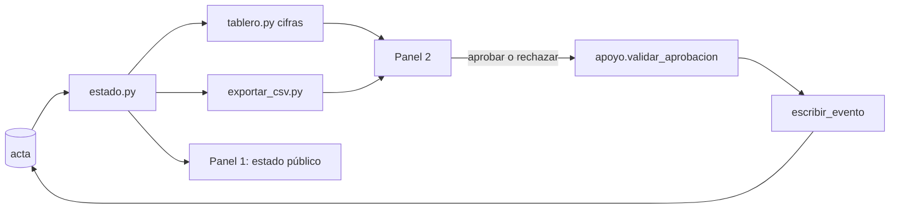

# Diseño: paneles y despliegue

Estado: **borrador para revisión del equipo**. Requisitos: `requirements.md`. Diseño general: `docs/Ruta-de-una-factura.pdf`.

## Principios

1. **Las pantallas solo muestran.** Todo cálculo vive en `acta/` (cifras, estado, CSV) y toda decisión en `engine/`.
2. **Una fuente de verdad:** el acta. Las pantallas leen proyecciones, nunca tablas propias.
3. **Una app, dos paneles.** `app/Panel_1_Proveedor.py` es la entrada; el Panel 2 vive en `app/pages/`.
4. **Texto de personas = texto plano** (nada de `unsafe_allow_html` con datos de usuario).

## Estructura

```
app/
├─ Panel_1_Proveedor.py     # portal abierto: estado público, facturas de ejemplo
├─ comun.py                 # sala por enlace, conexión al acta, selector de rol, formato
├─ apoyo.py                 # funciones puras: cola por rol, validar aprobación, formato de montos
└─ pages/
   ├─ 1_Tablero.py          # cifras, tabla, CSV, aviso de consistencia (refresco con st.fragment)
   ├─ 2_Cola_de_aprobacion.py
   ├─ 3_Calendario.py
   └─ 4_Acta.py             # solo lectura + verificación de cadena
acta/                       # ver specs/acta-y-csv/design.md
data/demo_semilla.py        # eventos de ejemplo de las maquetas (sustituir por el motor)
```

## Flujo de datos



## Sala y rol

- `comun.obtener_sala()` lee `st.query_params["sala"]`; si falta o es inválida, crea una sala con `salas.crear()` (carga la semilla) y actualiza el enlace.
- El rol vive en `st.session_state["rol"]`; `comun.exigir_rol()` detiene la página si no hay rol.

## Cola y aprobaciones (provisional)

`apoyo.validar_aprobacion(rol, nivel, motivo, actor, preparador)` aplica PP5.2 a PP5.4. Cuando exista `engine/guardarrail.py` (T9), esta función se sustituye por la suya y la pantalla no cambia.

## Refresco

`st.fragment(run_every=segundos_refresco)` solo en el tablero. Hay que verificar que la versión de Streamlit fijada lo soporte (pendiente P4).

## Riesgos

| Riesgo | Mitigación |
|---|---|
| Se muestra como pagada una factura cuya escritura falló | Mostrar el éxito solo después de que `escribir_evento` devuelva la fila (PP5.6) |
| El Panel 1 filtra reglas o motivos | Estado público con lista cerrada y prueba específica (PP2.1) |
| Texto con HTML en un motivo | Mostrar siempre con `st.text` / `st.write` sin HTML (PP7.3) |
