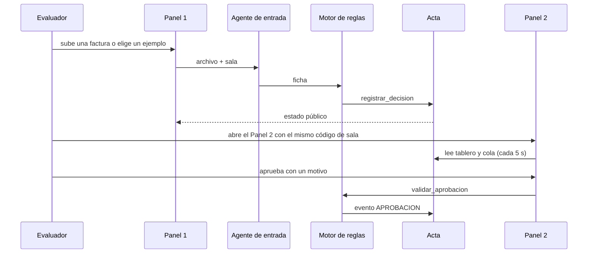

# Diseño: paneles y despliegue

Estado: **borrador para revisión del equipo**.
El diseño general y las maquetas están en `docs/Ruta-de-una-factura.pdf`. Este archivo baja a código la parte de pantallas y publicación.

Los nombres de funciones y de opciones de Streamlit y de Railway salen de lo que conozco. **Verifíquenlos en la documentación y en la versión que instalen antes de fijarlos.**

## Principios

1. **Una sola aplicación, un solo despliegue.** Dos paneles que comparten el código y la base de datos (PD1.1).
2. **La pantalla no decide ni calcula.** Muestra lo que devuelven el motor de reglas, el acta y el agente de entrada. Los bloqueos de verdad viven en el motor (PD4.5).
3. **Streamlit vuelve a ejecutar el script en cada acción.** Todo lo que cuesta (llamar al modelo, escribir en el acta) se protege con banderas en el estado de la sesión y con claves de idempotencia (PD6.4).
4. **Los textos viven en un solo archivo.** Así se revisan juntos (PD7.2).
5. **El Panel 1 no recibe datos internos.** Las funciones que lo alimentan solo devuelven el estado público (PD3.6).
6. **Fallar de forma visible.** Un aviso claro en vez de un error técnico o de un resultado falso (PD10).

## Estructura de carpetas

```
app/
├─ main.py                  # Panel 1: proveedor (página de inicio)
├─ pages/
│  └─ 1_Finanzas.py         # Panel 2: finanzas, con pestañas
├─ componentes/
│  ├─ sala.py               # crear, validar y reiniciar la sala; enlaces entre paneles
│  ├─ rol.py                # selector de rol, permisos de pantalla y actor
│  ├─ subida.py             # subida de archivos y botones de ejemplo
│  ├─ chat_proveedor.py     # chat con el agente de entrada
│  ├─ estado_publico.py     # estado de cada factura para el Panel 1
│  ├─ tablero.py            # cifras, tabla y descarga de CSV
│  ├─ cola.py               # cola de aprobación
│  ├─ detalle.py            # ficha, revisiones, conversación y acta de una factura
│  ├─ acta_vista.py         # tabla del acta y verificación
│  ├─ calendario_vista.py   # mes por días hábiles (capa 3)
│  ├─ reglas_vista.py       # formulario de reglas y chat de reglas
│  └─ resumen_vista.py      # conciliación (capa 3)
├─ textos.py                # todos los textos de la interfaz
├─ config.py                # lectura de variables de entorno, con valores por defecto
├─ limites.py               # mensajes por minuto y llamadas al modelo por día
└─ salud.py                 # comprobaciones y avisos de estado
.streamlit/config.toml      # tamaño de subida, XSRF, modo sin cabeza, tema
data/ejemplos/              # las 4 facturas de ejemplo y su resultado esperado
init_db.py                  # tablas, permisos y datos de ejemplo
prueba_humo.py              # comprobación después de cada despliegue
requirements.txt
railway.toml                # arranque y comprobación de salud
.env.example                # nombres de variables, sin valores
Dockerfile                  # opcional
```

## Flujo entre paneles



## Sala y enlaces (PD2)

```python
def obtener_sala():
    codigo = st.query_params.get("sala") or st.session_state.get("sala")
    if codigo and sala_valida(codigo):
        pass
    elif codigo:                                   # formato o código desconocido
        mostrar_aviso(textos.SALA_INVALIDA); ofrecer_crear = True
    else:
        codigo = salas.crear()                     # con los datos de ejemplo
    st.session_state["sala"] = codigo
    st.query_params["sala"] = codigo               # el enlace siempre lleva el código
    return codigo
```
- `sala_valida`: el código tiene `largo_codigo_sala` caracteres de un alfabeto fijo, y existe en la base.
- **Enlaces entre paneles:** `st.page_link` o `st.switch_page`, volviendo a poner el código en la dirección. Como alternativa, un enlace HTML a la ruta de la página con `?sala=CODIGO`. Verifiquen cuál conserva el parámetro en su versión.
- **Reiniciar:** `salas.reiniciar(codigo)` devuelve un código nuevo y se redirige con él (PD2.5).

## Panel 1 (PD3)

- **Distribución:** dos columnas. Izquierda, el chat (`st.chat_message` y `st.chat_input`). Derecha, la subida (`st.file_uploader`), los botones de ejemplo y el estado de las facturas.
- **Subida:** el tipo permitido sale de `config`; el tamaño máximo lo impone `.streamlit/config.toml` (`server.maxUploadSize`) y lo vuelve a comprobar `recepcion.py` de la spec de extracción.
- **Ejemplos:** cada botón lee `data/ejemplos/<nombre>` y llama a la misma función que la subida (PD11.2).
- **Procesar:**
```python
if archivo and not st.session_state.get(f"hecho_{huella(archivo)}"):
    with st.status("Leyendo tu factura…") as estado:
        ficha = agente_entrada.procesar(archivo, sala, preparador="evaluador")
        resultado = motor.evaluar(ficha, ...)
        motor.registrar_decision(resultado, ficha, ..., actor="motor de reglas")
        estado.update(label="Listo", state="complete")
    st.session_state[f"hecho_{huella(archivo)}"] = True
```
  La bandera evita que una nueva ejecución del script procese dos veces el mismo archivo, y la clave de idempotencia del acta cubre el resto.
- **Chat:** si `agente_entrada` tiene una pregunta pendiente, se muestra y el siguiente mensaje se procesa como respuesta. Si no, se responde con el mensaje de «solo puedo ayudar a confirmar los datos».
- **Estado:** `estado_publico.py` llama solo a la función de estado público del acta (AC4.3) y a la etapa de la lectura. No importa nada del motor ni de las reglas.

## Panel 2 (PD4 y PD5)

- **Rol:** `st.radio` con «Persona de finanzas» y «Senior de finanzas», guardado en `st.session_state["rol"]`. El actor que se envía al motor es `"Persona de finanzas (demo)"` o `"Senior de finanzas (demo)"`.
- **Pestañas:** `st.tabs(["Tablero", "Cola de aprobación", "Calendario", "Acta", "Reglas", "Resumen"])`. En el núcleo, solo las cuatro primeras sin el calendario; el resto aparece cuando se construya.
- **Cola:**
  - `persona` ve `nivel == PERSONA`. `senior` ve `nivel == SENIOR` y, con `st.toggle`, también `PERSONA`.
  - «Aprobar» y «Rechazar» llaman a `motor.validar_aprobacion` y, si pasa, a `escribir_evento`. Si no pasa, se muestra el motivo del rechazo.
  - El campo de motivo es obligatorio y se guarda en `session_state` para que un refresco no lo borre.
- **Detalle:** un `st.selectbox` de facturas y un contenedor con la ficha, las revisiones, la conversación y las filas del acta de esa factura.
- **Tablero:** `st.metric` para las cifras, `st.dataframe` para la tabla y `st.download_button` para los CSV. Las cifras vienen de `acta.tablero.cifras` y la comprobación de `comprobar_consistencia`.
- **Reglas:** formulario con los parámetros de `reglas.yaml` (`st.form`), botón «Ver vista previa» (`simular`), y «Confirmar». Si el cambio afloja, el botón de confirmar se desactiva hasta que el rol sea `senior`. El chat de reglas es de capa 3.

## Actualización automática (PD6)

```python
@st.fragment(run_every=f"{config.REFRESCO_SEGUNDOS}s")
def tablero_vivo(sala):
    cifras = acta.tablero.cifras(sala, periodo)
    ...    # solo lectura: métricas y tabla
```
- Solo los fragmentos de **lectura** se refrescan solos (tablero y lista de la cola). Los formularios (motivo, reglas) quedan fuera, para no perder lo escrito.
- Un botón «Actualizar ahora» fuerza la recarga.
- Si la versión de Streamlit no tiene `run_every` en fragmentos, la alternativa es un botón de actualizar y, si hay tiempo, un paquete de refresco automático.

## Textos y accesibilidad (PD7)

- `textos.py` es un diccionario (o un módulo de constantes) con todos los textos de la interfaz, agrupados por pantalla.
- Cada estado se muestra con una etiqueta de texto (por ejemplo, «Pagada», «Escalada») y, si se usa color, nunca es lo único que lo distingue.
- Los mensajes de error pasan por una función `mensaje_para_persona(error)` que devuelve un texto del diccionario y registra el detalle técnico solo en el servidor.
- Tablas anchas dentro de contenedores desplazables.

## Despliegue en Railway (PD8)

**Servicios del proyecto:** la aplicación (desde el repositorio) y PostgreSQL.

**Variables de entorno:**

| Variable | Valor |
|---|---|
| `ANTHROPIC_API_KEY` | La clave del modelo (solo en Railway, nunca en el repo) |
| `DATABASE_URL` | Referencia al PostgreSQL del proyecto |
| `MODELO_LECTURA` | Nombre del modelo de lectura (confirmar el vigente) |
| `LLAMADAS_MODELO_POR_DIA`, `MENSAJES_POR_MINUTO`, `MAX_FACTURAS_POR_SALA`, `REFRESCO_SEGUNDOS` | Límites de la demo |

**Archivos de configuración:**

`railway.toml` (a confirmar con la documentación de Railway):
```toml
[build]
builder = "NIXPACKS"

[deploy]
startCommand = "python init_db.py && streamlit run app/main.py --server.port $PORT --server.address 0.0.0.0 --server.headless true"
healthcheckPath = "/_stcore/health"
healthcheckTimeout = 100
restartPolicyType = "ON_FAILURE"
```

`.streamlit/config.toml`:
```toml
[server]
maxUploadSize = 5
enableXsrfProtection = true
headless = true

[browser]
gatherUsageStats = false
```

- `init_db.py` es idempotente: crea tablas, roles y permisos si no existen y carga los datos de ejemplo.
- La versión de Python se fija con un archivo que Railway lea (por ejemplo `.python-version`) y las dependencias en `requirements.txt` con versiones exactas.
- **Despliegue continuo:** cada subida a `main` publica de nuevo. Para no publicar algo roto, las pruebas corren antes (GitHub Actions) y la prueba de humo corre después.
- **Plan B local:** `python init_db.py && streamlit run app/main.py` con SQLite; y un `Dockerfile` opcional.

## Protecciones (PD9)

- **Mensajes por minuto:** ventana deslizante en memoria por sala, con `mensajes_por_minuto`.
- **Llamadas al modelo por día:** contador en la base de datos (`uso_modelo(dia, llamadas)`), con incremento atómico. Al llegar al tope, todas las llamadas nuevas usan el modo demo. Además, el tope de gasto se fija en la cuenta de la API.
- **Subidas:** tipo y tamaño en la configuración y otra vez en `recepcion.py`; no se escribe nada fuera del almacenamiento temporal de la sala.
- **XSRF:** activado en `config.toml`.
- **Base de datos:** la aplicación se conecta con el usuario de solo leer y añadir de la spec del acta.
- **Registros del servidor:** solo llamadas, tiempos y códigos de error. Nunca contenido de facturas ni claves.

## Salud y prueba de humo (PD10)

- `salud.py` comprueba la base de datos (una consulta simple) y si hay clave del modelo, y devuelve un estado que la pantalla muestra como aviso («Base de datos no disponible», «Modo demo»).
- **`prueba_humo.py`**, con dos modos:
  - **Contra los datos:** con la `DATABASE_URL` pública de Railway, crea una sala, procesa la factura de ejemplo «Normal», comprueba que la decisión es `PAGAR` y que la cadena del acta es correcta, y repite con «Beneficiario nuevo» (debe ser `ESCALAR` a `SENIOR`).
  - **Contra la dirección pública:** pide `/_stcore/health` y la página de inicio, y comprueba que responden.
- **Lista de comprobación manual** (en el README): abrir la demo desde otro computador, subir «Normal», abrir el Panel 2, ver la factura en el tablero, aprobar un caso escalado y descargar el CSV.

## Pruebas (PD12)

- **Con `AppTest` de Streamlit** (`streamlit.testing.v1`; confirmar que la versión lo incluya): se ejecuta cada panel sin navegador y se comprueban los textos y las acciones.
- **Panel 1 sin datos internos:** se recorren todos los textos que muestra y se comprueba que no aparecen palabras como «umbral», «límite» o «regla», ni los valores numéricos de `reglas.yaml`.
- **Permisos:** con el rol «persona», un caso `SENIOR` no se puede resolver.
- **Motivo obligatorio:** aprobar con el motivo vacío se rechaza.
- **Sala inválida:** un código mal escrito muestra el mensaje y no un error.
- **Idempotencia:** ejecutar dos veces la misma aprobación deja una sola fila en el acta.
- **Manuales anotados:** contraste, uso con teclado y vista en un teléfono.

## Riesgos

| Riesgo | Mitigación |
|---|---|
| Una nueva ejecución del script procesa dos veces la misma factura | Banderas en la sesión e idempotencia en el acta |
| El refresco automático borra lo que la persona escribe | Solo se refrescan los fragmentos de lectura; los formularios guardan su estado |
| El enlace entre paneles pierde el código de sala | Se vuelve a poner en la dirección en cada página y se prueba |
| Un visitante agota el saldo de la API | Límite diario de llamadas, modo demo y tope de gasto en la cuenta |
| El Panel 1 filtra una regla | Funciones de solo estado público y prueba que recorre todos los textos |
| Un cambio de Streamlit rompe una función | Versiones fijadas y plan B (botón de actualizar) |
| La base de datos se cae durante la demo | Aviso visible, sin simular que se guardó, y modo local de respaldo para el pitch |
| El despliegue falla a última hora | Desplegar de primero, prueba de humo, y poder volver a la versión anterior |
