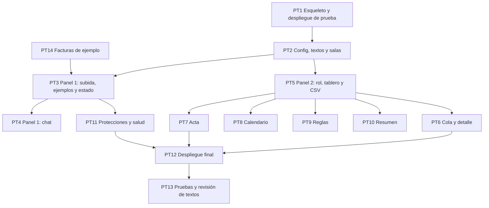

# Tareas: paneles y despliegue

Estado: **borrador para revisión del equipo**.
Requisitos: `requirements.md` · Diseño: `design.md`.

Las horas son **estimaciones mías**, para planear. Una tarea está lista cuando sus pruebas pasan o, si es visual, cuando la comprobación manual anotada está hecha.

Dueños sugeridos: **A** motor y pruebas · **B** agentes · **C** pantallas · **D** datos, evaluación y pitch.
Esta spec es de **C**, con B en el chat, D en los ejemplos, la prueba de humo y las pruebas de pantalla, y A en la conexión con el motor.

## Prioridad

| Capa | Qué incluye | Hasta cuándo |
|---|---|---|
| **Núcleo** | PT1 a PT3, PT5 a PT7, PT9 (formulario), PT11 a PT14 | Sábado 18:00 |
| **Capa 3** | PT4 (chat con el agente), PT8 (calendario), PT9 (reglas por chat) y PT10 (resumen) | Solo si sobra tiempo |

### Versión mínima si falta tiempo
- **Panel 1:** subir una factura o elegir un ejemplo, y ver el estado público. Sin chat.
- **Panel 2:** una sola página con tablero, cola de aprobación y acta. Reglas con formulario.
- Sin calendario, sin resumen de conciliación y sin chat de reglas.
- Mantener sin recortar: despliegue en Railway con la prueba de humo, la sala, el aviso de datos ficticios, el Panel 1 sin datos internos y las protecciones de PD9.

## Dependencias

## Tareas

### PT1. Esqueleto y despliegue de prueba
- **Dueño:** C (apoyo A) · **Estimación:** 1,5 h · **Capa:** núcleo · **Primera tarea del día**
- App mínima que lea la clave, llame al modelo una vez y guarde una fila. `requirements.txt`, `.streamlit/config.toml`, `railway.toml` y `.env.example`. Proyecto en Railway con PostgreSQL y las variables.
- **Cubre:** PD8.1 a PD8.4, PD8.7
- **Listo cuando:** otra persona abre la dirección pública desde otro computador y ve la fila guardada.

### PT2. Configuración, textos y salas
- **Dueño:** C · **Estimación:** 1 h · **Capa:** núcleo
- `config.py`, `textos.py`, `componentes/sala.py`: crear, validar y reiniciar, enlaces entre paneles, guía de tres pasos y aviso de datos ficticios.
- **Cubre:** PD1.1 a PD1.4, PD2.1 a PD2.6, PD7.1, PD7.2
- **Listo cuando:** el código de sala viaja entre paneles y un código inválido muestra un mensaje claro.

### PT14. Facturas de ejemplo
- **Dueño:** D · **Estimación:** 1 h · **Capa:** núcleo
- Cuatro archivos en `data/ejemplos/` (normal, repetida, beneficiario nuevo, con orden escondida), su resultado esperado y su respuesta guardada para el modo demo.
- **Cubre:** PD11.1, PD11.3
- **Listo cuando:** cada ejemplo da el resultado esperado en el motor.

### PT3. Panel 1: subida, ejemplos y estado
- **Dueño:** C · **Estimación:** 1,5 h · **Capa:** núcleo
- `subida.py`, `estado_publico.py` y los avisos de modo demo, con mensajes claros de rechazo y barra de avance.
- **Cubre:** PD3.1 a PD3.3, PD3.5 a PD3.8, PD11.2
- **Listo cuando:** subir «Normal» muestra «resuelta», y el Panel 1 no muestra ninguna regla.

### PT4. Panel 1: chat con el agente
- **Dueño:** C con B · **Estimación:** 1 h · **Capa:** capa 3
- `chat_proveedor.py` conectado con las aclaraciones del agente de entrada (ET6).
- **Cubre:** PD3.4
- **Listo cuando:** una pregunta del agente aparece en el chat y la respuesta del evaluador actualiza la ficha.

### PT5. Panel 2: rol, tablero y CSV
- **Dueño:** C · **Estimación:** 1,5 h · **Capa:** núcleo
- `rol.py`, estructura de pestañas, `tablero.py` con cifras, tabla y descarga de CSV, y el refresco automático de los fragmentos de lectura.
- **Cubre:** PD4.1 a PD4.4, PD5.1, PD6.1 a PD6.3
- **Listo cuando:** una factura subida en el Panel 1 aparece en el tablero sin recargar, y el CSV se descarga.

### PT6. Cola de aprobación y detalle
- **Dueño:** C con A · **Estimación:** 2 h · **Capa:** núcleo
- `cola.py` y `detalle.py`: casos por rol, aprobar y rechazar con motivo, elección de canal, ficha con original y aclarado, revisiones y filas del acta.
- **Cubre:** PD4.5, PD5.2 a PD5.4, PD5.10, PD6.4
- **Listo cuando:** la persona no puede resolver un caso `SENIOR`, aprobar sin motivo se rechaza, y repetir la acción no duplica el evento.

### PT7. Acta
- **Dueño:** C · **Estimación:** 0,75 h · **Capa:** núcleo
- `acta_vista.py`: tabla y verificación de la cadena.
- **Cubre:** PD5.5
- **Listo cuando:** se ve «cadena verificada: N de N filas», y una fila alterada a mano se señala.

### PT8. Calendario
- **Dueño:** C · **Estimación:** 1 h · **Capa:** capa 3
- `calendario_vista.py`: mes por días hábiles con los cuatro estados.
- **Cubre:** PD5.6
- **Listo cuando:** se ven las obligaciones del mes con su estado.

### PT9. Reglas
- **Dueño:** C (formulario) · B (chat de reglas) · **Estimación:** 1,5 h el formulario y 2 h el chat · **Capa:** núcleo el formulario, capa 3 el chat
- `reglas_vista.py`: formulario de parámetros con vista previa y confirmación, firma del senior si el cambio afloja, y el chat con el agente de reglas.
- **Cubre:** PD5.7, PD5.8
- **Listo cuando:** un cambio que restringe lo confirma la persona y uno que afloja exige al senior.

### PT10. Resumen de conciliación
- **Dueño:** C con B · **Estimación:** 0,5 h · **Capa:** capa 3
- `resumen_vista.py`: resumen, alertas, marcar como revisada y cerrar el periodo.
- **Cubre:** PD5.9
- **Listo cuando:** sin clave de API se ve el resumen de respaldo.

### PT11. Protecciones y salud
- **Dueño:** C con A · **Estimación:** 1,25 h · **Capa:** núcleo
- `limites.py`, `salud.py`, tabla `uso_modelo`, avisos de base de datos y de modo demo, y registros sin contenido.
- **Cubre:** PD9.1 a PD9.7, PD10.1, PD10.2
- **Listo cuando:** al superar los mensajes por minuto la aplicación lo explica, al agotar las llamadas diarias pasa a modo demo y sin base de datos no simula que guardó.

### PT12. Despliegue final
- **Dueño:** D con C · **Estimación:** 1 h · **Capa:** núcleo
- `init_db.py` idempotente, healthcheck, variables definitivas, dominio público, README con el enlace y la lista manual, y `prueba_humo.py`.
- **Cubre:** PD8.5, PD8.6, PD8.8 a PD8.10, PD10.3, PD10.4
- **Listo cuando:** la prueba de humo pasa contra Railway y la lista manual se hace desde otro computador.

### PT13. Pruebas y revisión de textos
- **Dueño:** D · **Estimación:** 1,25 h · **Capa:** núcleo
- Pruebas con `AppTest` de PD12, revisión de todos los textos y comprobaciones manuales de contraste, teclado y teléfono.
- **Cubre:** PD7.3 a PD7.6, PD12.1 a PD12.7
- **Listo cuando:** pasan las pruebas y las comprobaciones manuales quedan anotadas.

## Trazabilidad

| Requisito | Tarea | Archivo de pruebas |
|---|---|---|
| PD1.*, PD2.* | PT2 | `tests/test_app_sala.py` |
| PD3.* | PT3, PT4 | `tests/test_app_panel1.py` |
| PD4.* | PT5, PT6 | `tests/test_app_roles.py` |
| PD5.1 | PT5 | `tests/test_app_tablero.py` |
| PD5.2 a PD5.4, PD5.10 | PT6 | `tests/test_app_cola.py` |
| PD5.5 | PT7 | `tests/test_app_acta.py` |
| PD5.6 | PT8 | `tests/test_app_calendario.py` |
| PD5.7, PD5.8 | PT9 | `tests/test_app_reglas.py` |
| PD5.9 | PT10 | `tests/test_app_resumen.py` |
| PD6.* | PT5, PT6 | `tests/test_app_refresco.py` |
| PD7.* | PT2, PT13 | `tests/test_app_textos.py` y comprobaciones manuales |
| PD8.* | PT1, PT12 | `prueba_humo.py` |
| PD9.*, PD10.1, PD10.2 | PT11 | `tests/test_app_limites.py` |
| PD10.3, PD10.4 | PT12 | `prueba_humo.py` |
| PD11.* | PT14, PT3 | `tests/test_app_ejemplos.py` |
| PD12.* | PT13 | Pruebas de pantalla en `tests/` |

## Orden sugerido

1. **Ahora:** PT1, el despliegue de prueba, antes que cualquier pantalla. En paralelo, PT14 (D).
2. **A 12:30:** PT2 y PT3.
3. **12:30 a 16:00:** PT5, PT6 y PT7, junto con el motor y el acta.
4. **16:00 a 18:00:** PT11, PT12 y PT13. La prueba de humo prepara el control de las 18:00.
5. **Después del control de las 18:00:** PT4, PT8, PT9 (chat de reglas) y PT10, solo si sobra tiempo.
